<div align="center">

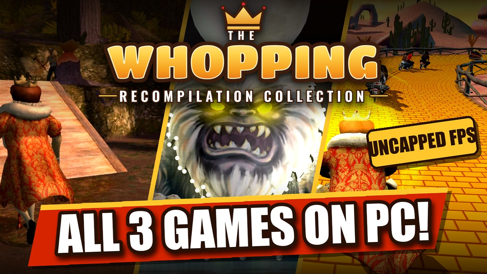

### Sneak King, Big Bumpin' and PocketBike Racer on PC, running natively, in one launcher made for the couch.

[](https://github.com/TekRantGaming/whopping-recompilation-collection/releases/latest)
&nbsp;
[](https://discord.gg/8eakYSvBZS)

[](https://github.com/TekRantGaming/whopping-recompilation-collection/releases/latest)
[](https://github.com/TekRantGaming/whopping-recompilation-collection/releases)


<br>

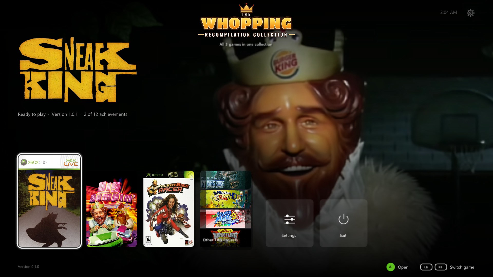

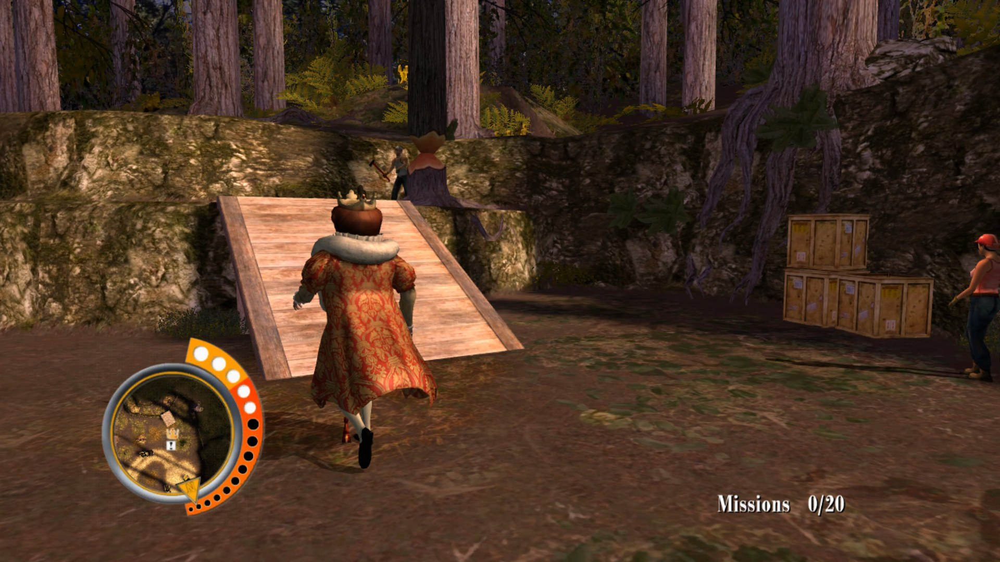
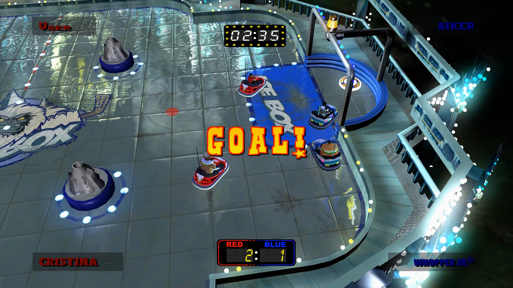
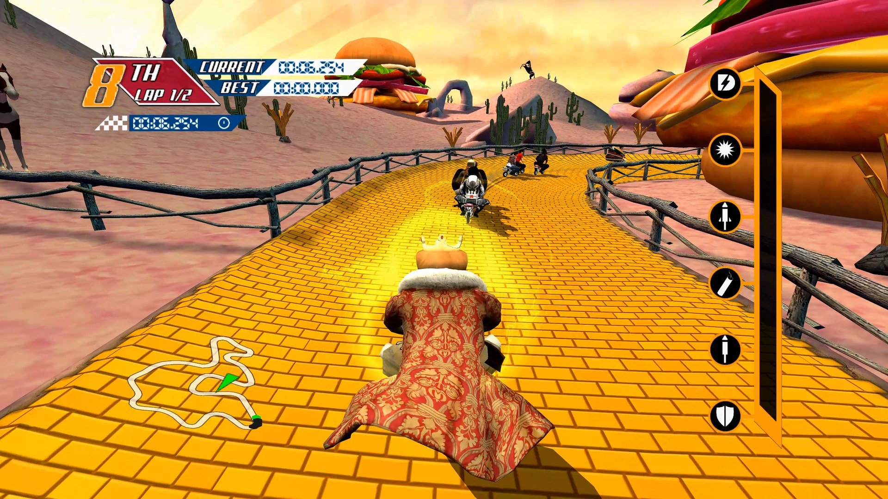

<sub>The original Xbox 360 game code, translated to native PC code with the <a href="https://github.com/rexglue/rexglue-sdk">ReXGlue SDK</a>. <b>No game files included</b>: bring your own copy of each Xbox 360 disc.</sub>

</div>

<br>

## At a glance

| | | |
| :--- | :--- | :--- |
| 🍔 **All 3 games** in one launcher | 🖥️ **Up to 4K and beyond**, at 60, 120 or an **unlimited** frame rate | ✨ **AMD FSR 1 and NVIDIA NIS** upscaling |
| 🎮 **Any controller**, or keyboard and mouse with your own keys | 🏆 **Achievements** with notifications in game, 12 per game | ↩️ **Back to the launcher** any time: hold Back + Start, or Esc |
| 💿 **Install from your own discs**, found on your PC by themselves | 🔄 **Updates itself** and every game | 💾 **Save backups** and restore in one click |
| 🛋️ **A console style dashboard** with sounds, made for a controller | 🪟 **Borderless fullscreen**, windowed, any monitor | 🦍 **Other TRG Projects**, with King Kong Recompiled ready to install |
| 🚂 **Add to Steam** with its own artwork, ready for Big Picture and the Steam Deck | 💬 **[Join the Discord](https://discord.gg/8eakYSvBZS)** right from Home | 🐧 **Linux and Steam Deck** too, as one AppImage |

<div align="center">

## The trailer

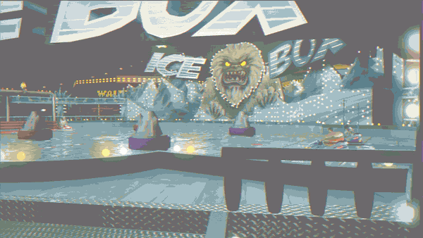

</div>

## The games

<div align="center">

### Sneak King

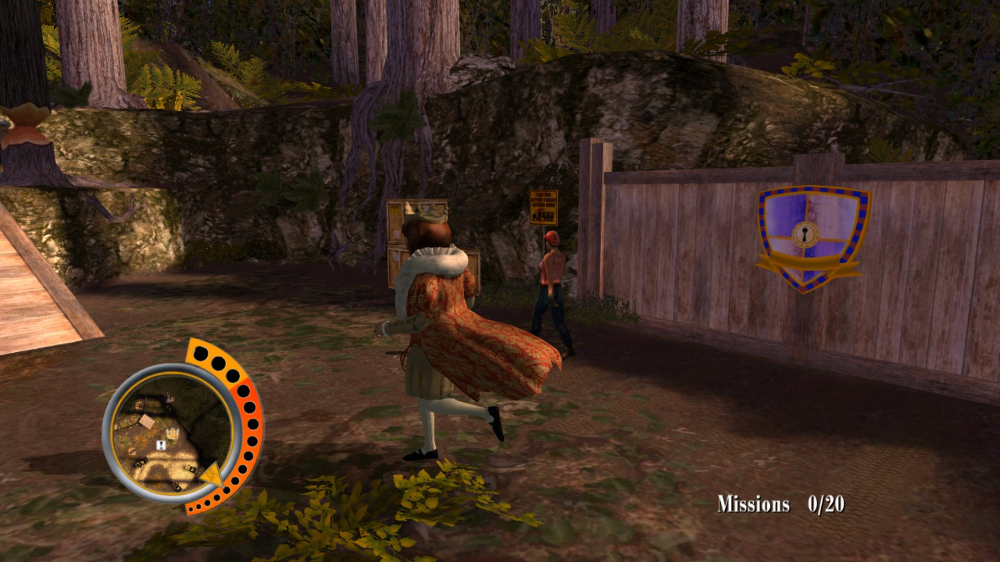
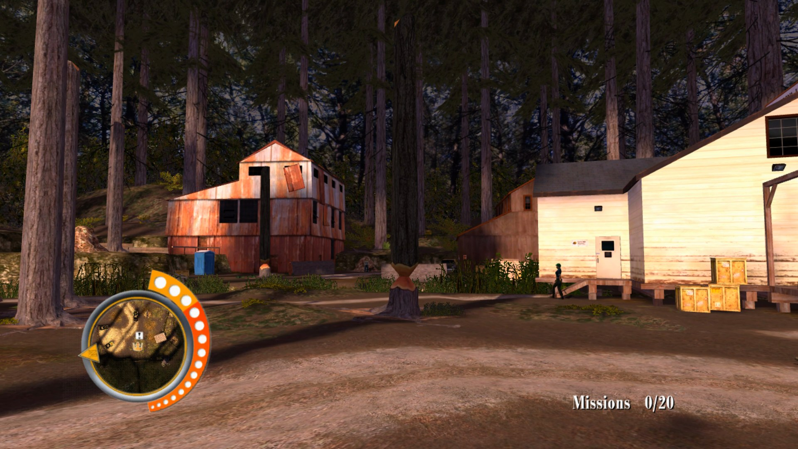
<sub><b>Deliver the goods. Don't get caught.</b> Sneak up on hungry people and surprise them with food, without being seen.</sub>

<br><br>

### Big Bumpin'

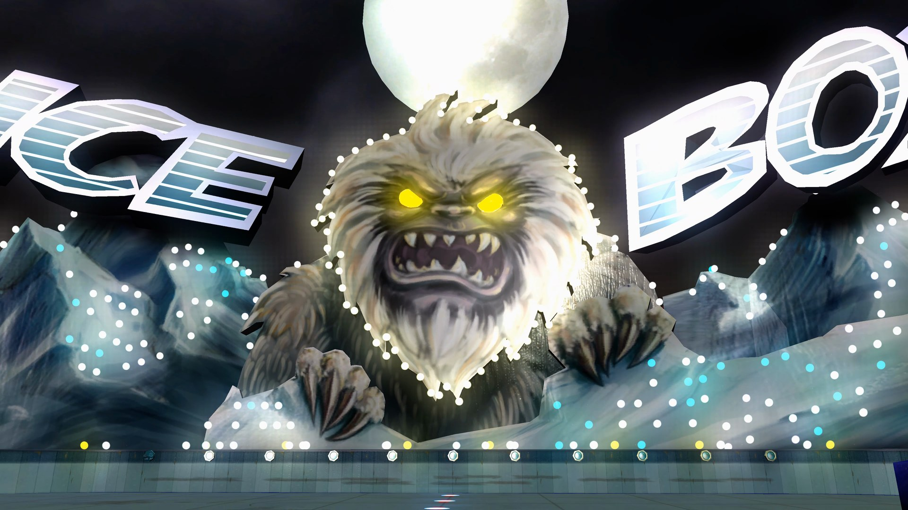
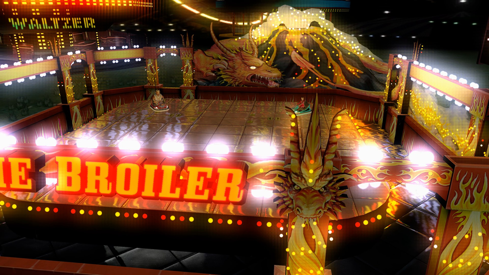
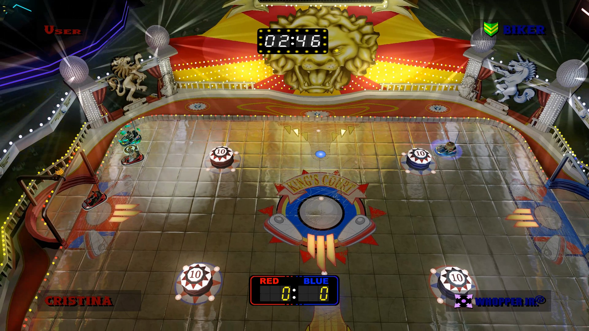

<sub><b>Bump like you mean it.</b> Bumper car battles at the fair, from the Ice Box to The Broiler and King's Court.</sub>

<br><br>

### PocketBike Racer

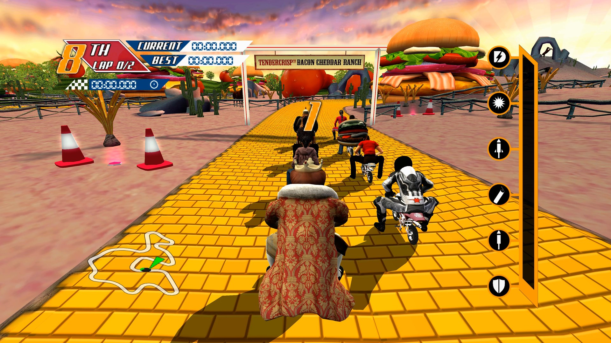
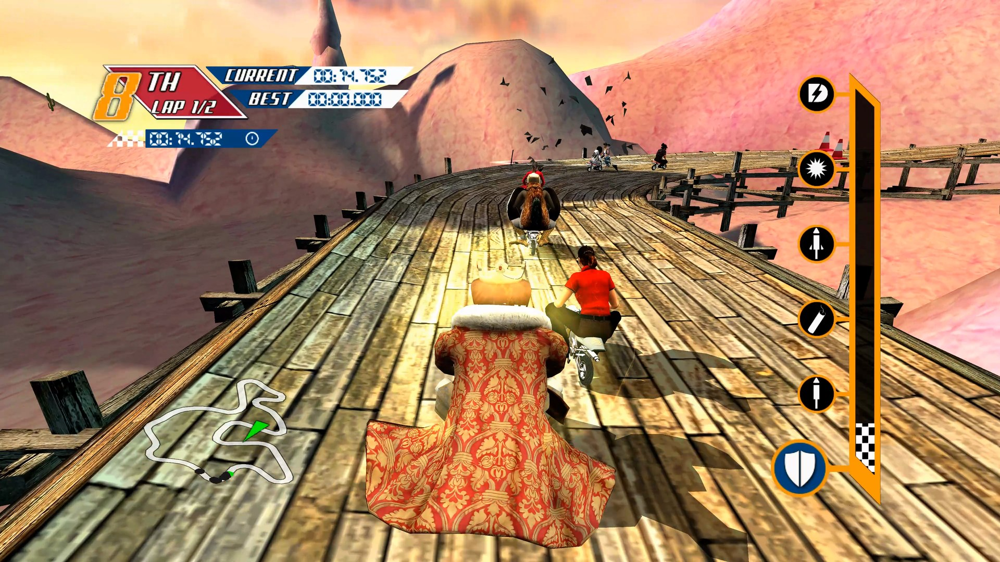
<sub><b>Small. Tiny. Minuscule.</b> Pocket bike races with boosts and giant burgers along the track.</sub>

</div>

<br>

## Getting started

**You need:** Windows 10 or 11 (64 bit) with a DirectX 12 graphics card, or Linux (including the Steam Deck and other handhelds) with Vulkan, and a disc image you made from your own disc for each game you want to play (see [Which discs you need](#which-discs-you-need)).

1. Download **WhoppingCollection-...-windows-x64.zip** from the [latest release](https://github.com/TekRantGaming/whopping-recompilation-collection/releases/latest) and unzip it anywhere. It holds the launcher and all three games, and everything stays in that folder, so it's portable.
2. Run **whopping_launcher.exe**. It opens in fullscreen on Home. Windows may warn about an unknown publisher the first time: choose **More info**, then **Run anyway**.
3. Pick a game and press **Play**. The first time, the launcher asks for your disc image of that game: it finds disc images on your PC by itself (or choose the file), checks the disc and copies the game files next to the game.
4. Press **Play** again, and from then on it starts straight away.

While you play, **hold Back and Start** on the controller, or **hold Esc**, to come back to the launcher. **No game files are included**: they come from your own discs. Your saves are kept in `Documents\sneak_king`, `Documents\big_bumpin` and `Documents\pocketbike_racer`.

### Linux and Steam Deck

1. Download **WhoppingCollection-...-linux-x86_64.AppImage** from the [latest release](https://github.com/TekRantGaming/whopping-recompilation-collection/releases/latest).
2. Make it executable (right click it, **Properties**, **Permissions**, **Allow executing file as program**, or `chmod +x` in a terminal) and run it. The launcher and all three games are inside.
3. Everything else works as on Windows: pick a game, press **Play**, and choose your disc image the first time.

The installed games and the launcher's settings go in `~/.local/share/whopping_collection`, and each game's saves and settings in `~/.local/share/sneak_king`, `~/.local/share/big_bumpin` and `~/.local/share/pocketbike_racer`. The AppImage updates itself like the Windows version. **Add to Steam** on Home puts it in your Steam library with its artwork, ready for Game Mode on a Steam Deck. The games draw with Vulkan; on a handheld, a higher power profile gives a higher frame rate (tested on a ROG Ally with Bazzite).

### Which discs you need

Only the title ID is checked, so any good dump of these discs works. These are the images the ports were made and tested with:

| Game | Title ID | Media ID | Version | Disc image | SHA1 | Installed |
| --- | --- | --- | --- | --- | --- | --- |
| Sneak King | `4D538802` | `5D787B9D` | `0.0.0.70` | 7,027,228,672 bytes | `BDE18507EBF74060D43625BE8CE2B20C604DAF3E` | about 1.6 GB |
| Big Bumpin' | `4D538801` | `56F9F46F` | `0.0.0.70` | 7,825,162,240 bytes | `51FBF8E78A25D466295568FBE9752C7070961779` | about 2.0 GB |
| PocketBike Racer | `4D538803` | `346E875D` | `0.0.0.70` | 7,825,162,240 bytes | `6A801254B1691717445253A1F4E068115F16F7B9` | about 1.2 GB |

The launcher's install screen shows every detail for each disc, MD5 and CRC32 too. To check a disc image yourself, run this in PowerShell and compare the result with the SHA1 above:

```powershell
Get-FileHash "C:\Games\Burger King Sneak King.iso" -Algorithm SHA1
```

## The launcher

Everything is set up before a game starts, with a controller, the keyboard or the mouse. Each game has its own page and its own settings.

<table>
<tr>
<td width="55%"></td>
<td valign="middle">

### Home
- **All three games** side by side, with their box art and artwork
- Each game shows at a glance whether it's **ready to play**, its version and your **achievements**
- **Settings** for the launcher, and **Other TRG Projects**
- **Add to Steam**: adds the collection to your Steam library as a non Steam game, with its own artwork (cover, banner, header, logo and icon), and switches Steam Input off for it so your controller keeps working. Steam closes for a moment while it's added and opens again afterwards; once it's in your library the button opens Steam instead
- **Discord**: joins the official server
- Plays with a **controller**, the **keyboard** or the **mouse**, with interface sounds

</td>
</tr>
<tr>
<td valign="middle">

### Game page
- **Play**, the only place a game starts
- **Settings** and **Saves and install** for that game
- Your **achievements** so far, your **save backups** and the **release notes** of its latest version

</td>
<td width="55%">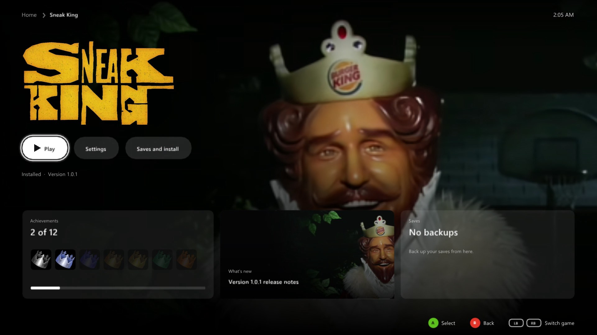</td>
</tr>
<tr>
<td>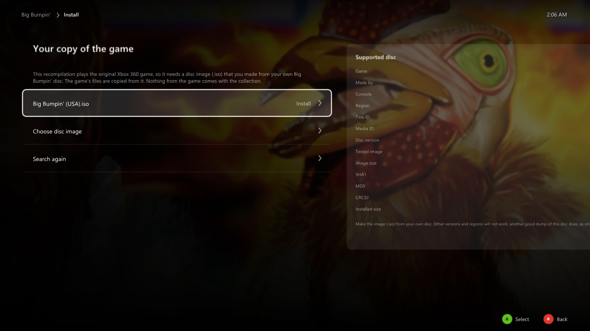</td>
<td valign="middle">

### Install from your own disc
- The launcher **finds disc images** on your PC by itself, or you **choose the file**
- A card shows **exactly which disc works**: title ID, media ID, version, size, SHA1, MD5 and CRC32
- It checks the disc really is that game, then copies the files with a progress bar

</td>
</tr>
<tr>
<td valign="middle">

### Display and Graphics
- **Fullscreen** or **windowed**, window size, **choose the monitor**, vertical sync
- **Frame rate**: 30 (like the Xbox 360), **60** (the default), 120, 144, 165, 240 or **no limit**. The game still runs at the right speed
- **Upscaler**: AMD FSR 1 or NVIDIA NIS, with Native, Quality, Balanced and Performance modes
- **Render resolution** from the original 720p up to 6x
- **FXAA** and **texture filtering** up to 16x
- **Keep the original shape** with black bars, or stretch to fill

</td>
<td width="55%"></td>
</tr>
<tr>
<td></td>
<td valign="middle">

### Controller, keyboard and mouse
- **Invert the camera** left/right and up/down, separately
- **Camera sensitivity**, **stick deadzone** and **vibration**
- **Remap any button** on your controller
- **Keyboard and mouse** with mouse look, mouse sensitivity and your own key bindings

</td>
</tr>
<tr>
<td valign="middle">

### Achievements
- All **12 achievements** of each game, with their pictures and gamerscore
- **Notifications in game** when you unlock one, with their sound on or off and its volume
- A **test button** to see and hear it

</td>
<td width="55%">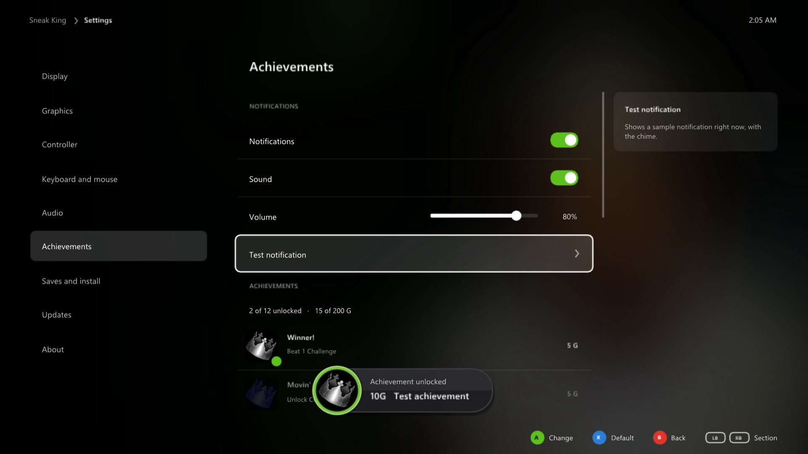</td>
</tr>
<tr>
<td></td>
<td valign="middle">

### Other TRG Projects
- The other **TekRant Gaming** ports, with their artwork and a link to each
- **King Kong Recompiled** downloads and plays right from here

</td>
</tr>
</table>

### Saves and updates

Each game's **Saves and install** page backs up your saves and restores them, opens the save, backup and game folders, reinstalls from your disc or removes the game. When the launcher opens it checks GitHub for new versions of itself and of each game and **installs them by themselves**, restarting into a new launcher once nothing else is going on; your games, saves and settings stay as they are. Turn that off in the launcher's own **Settings**.

## Xbox 360 vs PC

| | Xbox 360 | PC |
| --- | :---: | :---: |
| Resolution | 1280 x 720 | up to 6x (7680 x 4320) |
| Frame rate | 30 fps | 30, 60, 120, 144, 165, 240 or no limit |
| Upscaling | none | AMD FSR 1 or NVIDIA NIS, four modes each |
| Anti aliasing | console | FXAA, or higher resolutions |
| Texture filtering | console | up to 16x |
| Display | TV | borderless fullscreen or windowed, any monitor |
| Controls | Xbox 360 controller | any controller, remapping, keyboard and mouse |
| Achievements | console | notifications in game, with sound |
| Three games | three discs | one launcher |

## Good to know

### Hotkeys

| Key | Action |
| --- | --- |
| Hold <kbd>Back</kbd> + <kbd>Start</kbd>, or hold <kbd>Esc</kbd> | back to the launcher while playing |
| <kbd>F11</kbd> | the launcher fullscreen or windowed |

### Reporting a problem

Please open an [issue](https://github.com/TekRantGaming/whopping-recompilation-collection/issues) with the game, what happened, your CPU, graphics card and the resolution and frame rate you play at, or ask on the [Discord](https://discord.gg/8eakYSvBZS).

## About the games

*Sneak King*, *Big Bumpin'* and *PocketBike Racer* were made by the Arcade division of Blitz Games and published by King Games in 2006. They were sold at Burger King restaurants from late November to Christmas Eve 2006, played on both the original Xbox and the Xbox 360, and more than 2 million copies were sold in their first four weeks.

Until now the only way to play them was on a console. This collection runs all three natively on Windows and adds the options you would expect from a PC release.

<details>
<summary><b>Building from source (for developers)</b></summary>

See [BUILDING.md](BUILDING.md). The game code is generated from each game's own `default.xex`, so building a game needs your own disc too.

</details>

## Credits

- **Sneak King**, **Big Bumpin'** and **PocketBike Racer** by Blitz Games (Blitz Arcade), published by King Games in 2006.
- [**ReXGlue SDK**](https://github.com/rexglue/rexglue-sdk), which does the code translation and runs the games, built on the work of [**Xenia**](https://github.com/xenia-project/xenia) and [**XenonRecomp**](https://github.com/hedge-dev/XenonRecomp).
- [**Dear ImGui**](https://github.com/ocornut/imgui), [**SDL**](https://www.libsdl.org) and [**stb**](https://github.com/nothings/stb) for the launcher.
- The [**TRG Launcher**](https://github.com/TekRantGaming/trg-launcher) (updater and settings), shared by the TekRant Gaming ports.
- Game artwork in the launcher from [**SteamGridDB**](https://www.steamgriddb.com), downloaded when the launcher runs.
- The Discord and Steam marks from [**Simple Icons**](https://simpleicons.org) (CC0). Discord and Steam are trademarks of their owners.
- Upscaling: [**AMD FidelityFX Super Resolution 1**](https://github.com/GPUOpen-Effects/FidelityFX-FSR) and the [**NVIDIA Image Scaling SDK**](https://github.com/NVIDIAGameWorks/NVIDIAImageScaling), both MIT licensed.

> [!NOTE]
> **AI disclosure:** this collection was made almost entirely with Claude Code (Anthropic). The repository owner directed and tested the work; the AI did the analysis, code, tools and documentation.

> [!IMPORTANT]
> This project is not affiliated with or endorsed by Burger King, Blitz Games, King Games, Microsoft, Valve or Discord. All trademarks belong to their owners. It contains no game code or assets. Do not open issues asking for game files.
